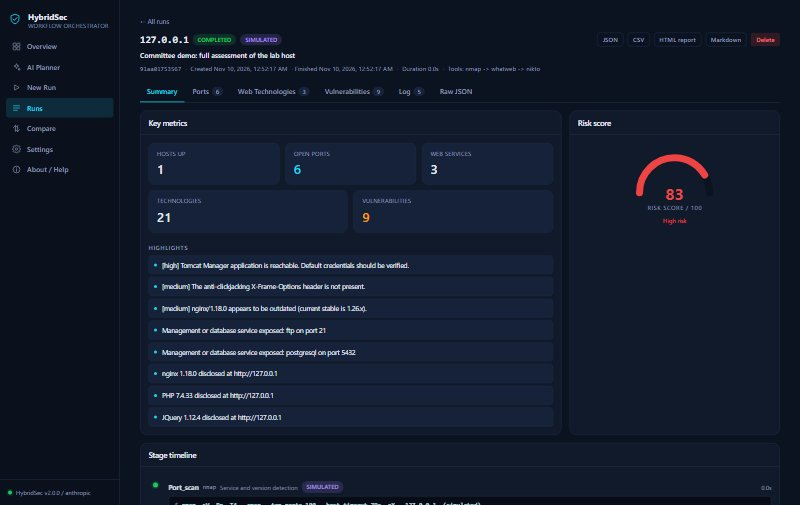

# HybridSec

Senior project "AI-Driven Technique for Cybersecurity Tools Hybridization" by Mubarak Al-Hajri, Mohammedmuh Al-Haj and Ali Al-Yafei, Community College of Qatar.

AI-planned hybrid cybersecurity tooling with a built-in dashboard.



This repository holds the program, its tests and its technical guides. The project report, the
presentation and the exhibition banner are not part of it.

HybridSec chains established open-source security tools into a single correlated workflow:

```
 objective + tools ──► AI planner ──► plan (steps, inputs, outputs, safety controls)
                                          │
 target ──► Nmap (port_scan) ──► WhatWeb (web_fingerprint) ──► Nikto (web_vuln_scan, optional)
                                          │
                               correlated run: ports + technologies + findings
                                          │
                 dashboard · risk score · history · compare · JSON/CSV/HTML/Markdown reports
```

It is the reworked version of the "Senior Project" FastAPI platform. The original two endpoints,
`POST /ai/plan` and `POST /hybridizations/execute`, still exist as aliases, so the earlier Swagger
walkthrough keeps working.

> **Legal notice.** Only scan systems you own or have written permission to test. Every run
> requires `authorized: true`, and an operator can further restrict targets with an allow-list.

---

## 1. Quick start

Requirements: Python 3.10 or newer. Nmap, WhatWeb and Nikto are optional at install time; the
dashboard shows which ones it found and offers a **simulation mode** so you can demonstrate the
whole pipeline on a machine without them.

Get the code with Git, or download it as a zip from the repository page:

```bash
git clone https://github.com/mubarakalhajriqatar-dotcom/hybridsec.git
```

### Windows (PowerShell)

```powershell
cd hybridsec
.\run.ps1
```

If PowerShell answers "running scripts is disabled on this system", start `run.cmd` instead
(double-click it, or type `.\run.cmd`): it runs the same script with the execution policy bypassed for
that one process and changes nothing on the machine.

### Linux, macOS, WSL / Ubuntu

```bash
cd hybridsec
chmod +x run.sh
./run.sh
```

On Ubuntu or WSL, if the script reports that the virtual environment cannot be created, install the
venv module first with `sudo apt install python3-venv` and run it again.

The first start creates a `.venv`, installs `requirements.txt` and copies `.env.example` to `.env`.
Then open:

| What | URL |
|---|---|
| Dashboard | http://127.0.0.1:8000/ |
| Swagger UI | http://127.0.0.1:8000/docs |
| Health | http://127.0.0.1:8000/api/health |

Manual start (same thing the scripts do):

```bash
python3 -m venv .venv                                 # Windows: python -m venv .venv
.venv/bin/python -m pip install -r requirements.txt   # Windows: .venv\Scripts\python -m pip install -r requirements.txt
.venv/bin/python -m uvicorn app.main:app --host 127.0.0.1 --port 8000   # Windows: .venv\Scripts\python -m uvicorn ...
```

### Installing the scanners

| Tool | Ubuntu / Kali / WSL | Windows |
|---|---|---|
| Nmap | `sudo apt install nmap` | https://nmap.org/download.html (adds `nmap` to PATH) |
| WhatWeb | `sudo apt install whatweb` | run HybridSec inside WSL |
| Nikto | `sudo apt install nikto` | run HybridSec inside WSL |

Restart the server after installing a tool; the Overview page re-detects them.

---

## 2. Using the dashboard

1. **Overview**: server health, AI provider in use, which tools are installed, KPIs, recent runs.
   **Settings** (in the sidebar) holds the API key, provider choice and scanning limits.
2. **AI Planner**: choose tools, describe the objective, get a structured plan (summary, ordered
   workflow with command templates, inputs, outputs, safety controls, limitations). Plans are saved.
   Type feedback under a plan and click *Refine* to get a new revision that applies it (the rules
   planner cannot interpret feedback, so without an AI provider the revision repeats the plan with a
   note saying so); revisions are chained (each shows its parent and revision number) so you can
   document how the design evolved.
3. **New Run**: enter a target, tick the authorization box, pick tools or a saved plan, choose a
   profile for each ticked tool from the drop-down under it (Nmap: service and version detection, a
   quick port scan, default scripts or polite timing; WhatWeb: aggression level 1, 3 or 4; Nikto: all
   checks or one family of them), set the time budget and top-ports count, optionally enable
   simulation, start.
4. **Run detail**: live progress while stages execute, then Summary, Ports, Web Technologies,
   Vulnerabilities, Log and Raw JSON tabs. Download JSON, CSV, HTML or Markdown reports. A stage
   whose tool produced no usable output is marked failed. A stage that did not examine everything it
   was given (Nmap stopped at its limit, a host timeout, URLs skipped, a probe stopped at its limit or
   by the server's shutdown, a probe that could not start, a tool that produced nothing for a URL, or a
   Nikto that stopped early on a URL, for example after too many errors) is marked *partial* with a
   note saying what is missing. A run that completes with such a stage, or with a failed later stage,
   carries a *partial* pill in the history, a notice in the reports and a warning in the comparison; a
   failed run exports its coverage as *failed*, and a CSV without any result row still holds one `run`
   row that says how the run ended. A URL that gave no HTTP response is recorded as unreachable, which
   is a result. The dashboard and the reports show a risk score only for a completed run; a failed one
   is shown as not scored.
5. **Runs**: history table, delete, select two runs and **Compare** (ports added/removed/changed,
   technologies added/removed, findings added/removed, and the risk delta when both runs completed).
6. **Custom tools**: register an extra command-line tool without changing code: a name, the program
   (`curl`, `whois`, `sslscan` and a few other information-gathering programs are allowed by default),
   its arguments with `{target}` or `{url}`, whether it runs once on the target or once per web URL, and
   a time limit per call. It then appears on New Run and runs after the built-in tools (at least one of
   them is required, and it cannot be added to a run that follows a plan). Its output is shown on the
   run's **Tool output** tab and in the reports as text; it is never parsed into findings or scored.
   Each call there says how it ended: its exit code, or that it was stopped at its time limit, for
   printing too much or by the server shutdown, could not start, or was only simulated; a call whose
   output the run's limit on custom-tool output cut says so too. The page marks a program that is found
   but refused as *refused*, and lists a stored tool whose definition can no longer be read as
   *unreadable*, with a Delete button. Custom tools can only be added, listed and run from the machine
   running HybridSec, but a run keeps its own copy of them (program, arguments and command lines) and
   their output, and runs can be read by any client the Host check admits, so keep secrets out of the
   arguments.

A safe first test: target `127.0.0.1`, authorization ticked, simulation on. Then repeat with
simulation off once Nmap is installed.

---

## 3. AI planner configuration

The planner works without any key using a deterministic rules engine. To use a language model you
need credentials for the provider, normally an API key (the `auto` provider also picks up an
`ANTHROPIC_AUTH_TOKEN` or an `ant auth login` profile found in the environment):

- **Anthropic**: https://console.anthropic.com, add billing, then Settings > API Keys > Create Key
  (keys start with `sk-ant-`).
- **OpenAI or any OpenAI-compatible service**: https://platform.openai.com/api-keys (keys start with `sk-`).

The easiest way to add it is the dashboard's **Settings** page: paste the key, click *Save key*, then
*Test planner*. The app writes the key to `.env` (the API never returns it) and uses it on the next
request, so no restart is needed. Settings can only be changed from the machine running the server.

You can also edit `.env` directly:

```ini
# Anthropic (default when a key is present)
ANTHROPIC_API_KEY=sk-ant-...
ANTHROPIC_MODEL=claude-opus-5-5

# or any OpenAI-compatible endpoint
OPENAI_API_KEY=sk-...
OPENAI_MODEL=gpt-4o-mini
OPENAI_BASE_URL=https://api.openai.com/v1

# force one backend: auto | anthropic | openai | rules
HYBRIDSEC_AI_PROVIDER=auto
```

`.env` is re-read on every request and its non-empty values take precedence over variables in the
process environment (a blank line such as `ANTHROPIC_API_KEY=` means "not set here" and never masks a
real environment variable; the Settings page therefore shows a key that comes from the server's
environment as "Set in environment" and cannot clear it, and warns when a value saved blank stays overridden
by the environment). Set `HYBRIDSEC_ENV_FILE` to another path to use a different file, or to
an empty string to ignore `.env` entirely (the test-suite points it at a private temporary file so your
real `.env` is never read or modified by tests). `HYBRIDSEC_DATA_DIR` is read once at startup.

The model is told which commands the pipeline executes with each tool's default profile, so the command
templates in a plan describe the real implementation (a run may swap in another catalogued profile, which
the run page records); every template is then set to that command in code, so a plan never shows flags
the model added. It is asked for JSON that matches a strict schema. Its output is then normalised: only
the requested tools are kept (one step per tool; when the model adds a tool that was not selected to a
new plan, the plan's `note` says it was removed and that the plan's other text may still mention it),
stages are mapped from the tool registry, and authorization is always required. Feedback may change the
tool set, so a refined revision may keep any of the three built-in tools; any other tool the model's
revision names (plans never contain custom tools) is removed, with the outputs and rate limits that
describe only it, and a line in the plan's limitations names it, because a refined plan's `note` only
says that the feedback was not applied. If the provider errors out (bad key, no credit, network), the
response falls back to the rules engine and carries a `note` explaining why, so a run is never blocked by
the AI service.

With Anthropic, requests enable the API's server-side refusal fallback. Security-tooling prompts
can be declined by the configured model's safety classifier; the API then continues the same request
on a fallback model and the plan's `model` field shows which model actually answered (for example
`claude-opus-4-8` when `claude-opus-5-5` declined). The dashboard displays that model on the plan.

---

## 4. Safety controls

| Control | Where |
|---|---|
| `authorized: true` is mandatory | `app/security.py`, every execute request |
| Target validation: IP, hostname or CIDR only; `/24` (IPv4) and `/120` (IPv6) maximum; no shell characters, URLs or flags | `app/security.py` |
| Optional allow-list `HYBRIDSEC_ALLOWED_TARGETS=127.0.0.1,192.168.1.0/24,*.lab.example.edu` | `.env` |
| Address ranges, lists and wildcards in Nmap syntax (`10.0-255.0.1`, `10.0.0.*`, `a,b`) are rejected; only one host, IP or small CIDR per run | `app/security.py` |
| Host header allow-list (loopback names plus `HYBRIDSEC_ALLOWED_HOSTS`) and Origin / Sec-Fetch-Site checks on state-changing requests block DNS-rebinding and cross-site abuse; every response forbids framing by other sites (`X-Frame-Options: DENY`, CSP `frame-ancestors 'none'`) against clickjacking | `app/main.py` |
| Settings endpoints answer only to loopback peers, never return secrets, and reject line breaks, control characters, single quotes, `${` and a trailing or doubled backslash in values | `app/routers/settings_api.py` |
| Commands are argument lists, never a shell; hard timeouts per stage; one deadline for the whole run; output size capped; scanner processes are killed on shutdown | `app/tools/runner.py`, `app/hybrid.py` |
| WhatWeb follows redirects on the same site only, so a probe never leaves the authorised host | `app/hybrid.py` |
| Non-exploitative flags only (some profiles are still intrusive), from a fixed catalogue of per-tool profiles: `nmap -sV -Pn -T4 --open --top-ports N`, `whatweb -a 1` and `nikto -maxtime` by default; the other profiles add `-sC`, `-T2`, `-a 3`/`-a 4` or a Nikto `-Tuning` subset, and the quick Nmap profile leaves out `-sV`. A request names a profile key, never a flag | `app/tools/registry.py`, `app/hybrid.py` |
| Web fingerprinting capped at 12 services per run | `app/hybrid.py` |
| Concurrent runs capped (`HYBRIDSEC_MAX_CONCURRENT_RUNS`, default 3); extra requests get HTTP 429 | `app/routers/hybrid.py` |
| A run started from a plan executes that plan's workflow; it may leave a planned tool out but can never add one | `app/routers/hybrid.py` |
| Custom tools are registered, listed and run only from the machine running HybridSec, and the error for an unknown tool names only the custom tools a run can use, and only to that machine. A run keeps its own copy of its custom tools (program, arguments, command lines) and their output, which any client the Host check admits can read with the run, so secrets stay out of the arguments. Each call has a time limit, stays inside the run's deadline and is stopped once it prints more than 50,000 characters on standard output or on standard error (5,000 characters of standard error are kept). All the custom tools of a run together take one bounded share of the time budget (weight 0.2, a sixth when all three built-in tools run) from the built-in stages, but never the minimum times those stages need; when the budget left after those minimums cannot give a custom call its 10-second minimum, the custom stages get no share and the built-in stages keep the shares they would have without them; a custom call then runs only on time the built-in stages leave over, and when none is left the stage names the budget that would be enough. The output is kept as text and never scored | `app/routers/tools.py`, `app/routers/hybrid.py`, `app/hybrid.py`, `app/tools/runner.py` |
| A custom tool's program must be on `HYBRIDSEC_CUSTOM_PROGRAMS` (default: curl, dig, host, nslookup, whois, sslscan, sslyze, traceroute, tracert; an entry written as a path, such as `C:\Tools\curl.exe`, allows only that file (a relative path is read from the folder HybridSec was started from), and one written as a name allows that program from any folder) and is checked on the file that really runs. Known shells, interpreters and launchers (remote shells and database, file-transfer and code consoles among them), script files, attack tools and the built-in scanners are always refused by name, and so is any program inside HybridSec's own folder; the allow-list decides the rest. Only `{target}` and `{url}` are filled in, from the validated target. The arguments may not contain fixed addresses written as four dotted numbers or in IPv6, URLs (`://`), host names (also followed by `?` or `#`, or after the single slash of `http:/host`; %-escapes are decoded for these and the address test), `@` forms other than `dig @{target}`, two slashes or backslashes where a path starts or two backslashes anywhere (network paths; `{url}/a//b` is allowed), curl's `[ ]` ranges, options that route the traffic or read options from a file (such as curl `-K`/`--config`, `-x`/`--proxy`, `--connect-to` and `--resolve`, and `whois -h`), exploit wording or values that look like secrets; a file name that looks like a host is written with its folder (`./out.txt`). Everything else typed into the arguments is trusted (for example curl `-L`, an IPv4 address in a short or numeric form such as `127.1`, or a single-word host name), and a copied and renamed program cannot be recognised by name, so the allow-list is the real gate | `app/tools/custom.py` |
| Runs interrupted by a server restart are marked failed on startup instead of staying "running" forever | `app/storage.py` |
| CSV reports neutralise spreadsheet formula injection; HTML reports escape every value | `app/reports.py` |
| Results stored locally in SQLite; runs can be deleted | `app/storage.py` |

---

## 5. API

All endpoints are documented in Swagger at `/docs`. Main ones:

| Method | Path | Purpose |
|---|---|---|
| GET | `/api/health` | version, AI provider, tool availability, limits and run totals |
| GET | `/api/tools` | supported tools, installed or not, install hints, and each tool's profiles |
| GET / POST | `/api/tools/custom` | list or register custom tools (local machine only); `blocked` marks a tool whose program is found but refused, and `unreadable` names stored tools whose definition can no longer be read |
| DELETE | `/api/tools/custom/{name}` | remove a custom tool, also one listed as unreadable (the name percent-encoded, so one with `/`, `?`, `#` or `%` can be removed too); runs keep their own copy (local machine only) |
| POST | `/api/ai/plan` | generate and save a plan |
| GET | `/api/ai/plans`, `/api/ai/plans/{id}` | saved plans |
| POST | `/api/ai/plans/{id}/refine` | new revision of a plan from feedback (`{"feedback": "..."}`) |
| POST | `/api/hybridizations/execute` | start a run (returns `202` with the queued run) |
| GET | `/api/runs`, `/api/runs/{id}` | history, newest first (`limit` up to 1000; the `X-Total-Count` header gives the number stored), and live run state; each custom-tool output records how the call `ended` and whether the run's limit on custom-tool output cut it (`run_limit`) |
| DELETE | `/api/runs/{id}` | remove a finished run |
| GET | `/api/runs/{id}/report?format=json\|csv\|md\|html` | download a report |
| GET | `/api/compare?base=ID&other=ID` | diff two runs; `risk_delta` is `null` unless both runs completed |
| GET / PUT | `/api/settings` | read (secrets masked) or update configuration; writes `.env`; local machine only |
| POST | `/api/settings/test-planner` | run a small planning request with the configured provider (local machine only) |
| POST | `/ai/plan`, `/hybridizations/execute` | legacy aliases from the original project |

Example request bodies:

```json
POST /api/ai/plan
{
  "tools": ["nmap", "whatweb"],
  "objective": "Create a hybrid cybersecurity tool that uses Nmap to discover open ports and WhatWeb to identify technologies running on discovered web services."
}
```

```json
POST /api/hybridizations/execute
{
  "target": "127.0.0.1",
  "authorized": true,
  "timeout_seconds": 180,
  "top_ports": 100,
  "tools": ["nmap", "whatweb"],
  "profiles": {"nmap": "quick", "whatweb": "stealthy"},
  "simulate": false
}
```

`profiles` is optional: a tool that is not named uses its default profile (the first one `/api/tools` lists
for it). A profile may only name a tool that is part of the run; an unknown key answers `400` with the
keys the tool offers.

---

## 6. Project layout

```
hybridsec/
├── app/
│   ├── main.py            FastAPI app, routers, dashboard mount, legacy aliases
│   ├── config.py          settings from .env
│   ├── schemas.py         Pydantic models (plans, runs, findings, reports)
│   ├── security.py        target validation and scope allow-list
│   ├── planner.py         AI planner: Anthropic / OpenAI-compatible / rules
│   ├── hybrid.py          pipeline engine, stage handlers, summary, simulation
│   ├── storage.py         SQLite persistence
│   ├── reports.py         JSON / CSV / Markdown / HTML renderers
│   ├── compare.py         run diffing
│   ├── envfile.py         comment-preserving .env writer used by the Settings page
│   ├── routers/           ai.py, hybrid.py, runs.py, tools.py, settings_api.py
│   └── tools/             registry.py (tool catalogue), custom.py (custom tool rules), runner.py (safe
│                          subprocess), parsers.py
├── dashboard/             index.html, styles.css, app.js (no build step)
├── tests/                 twelve test modules (655 cases), all offline
├── scripts/preflight.py   pre-demonstration health check
├── docs/                  ARCHITECTURE.md, DASHBOARD.md, TESTING_GUIDE.md, screenshots/
├── data/                  SQLite database (created at first start)
├── .env.example  requirements.txt  requirements-dev.txt  pyproject.toml  run.cmd  run.ps1  run.sh
```

Run the tests:

```bash
.venv/bin/python -m pytest -q          # Windows: .venv\Scripts\python -m pytest -q
```

Before a demo, run the preflight check. It verifies Python, dependencies, configuration, tool
availability and the port, then boots the application in isolation and exercises health, planning, a
simulated run and a report download, without touching your database or `.env`:

```bash
.venv/bin/python scripts/preflight.py  # Windows: .venv\Scripts\python scripts\preflight.py
```

### Documentation

| File | Purpose |
|---|---|
| `docs/ARCHITECTURE.md` | Plain-language guide to every backend module, the request flow, the pipeline and the design decisions |
| `docs/DASHBOARD.md` | How the dashboard is organised, routing, polling, settings saving, accessibility |
| `docs/TESTING_GUIDE.md` | Install, automated checks, a 28-item manual checklist and how to report a bug |
| `docs/screenshots/` | Two dashboard screenshots from simulation mode: the overview and a finished run |

---

## 7. Extending with another tool

For a tool whose output only needs to be kept and read, no code change is needed: register it on the
dashboard's **Custom tools** page (section 2). Its output is then kept as text but not parsed, correlated
or scored. To make a tool a full pipeline stage with parsed, scored results:

1. Add a `ToolSpec` to `app/tools/registry.py` with a new stage name, and add that stage to `STAGE_ORDER` at its place in the pipeline.
2. Write a parser in `app/tools/parsers.py`.
3. Add a stage handler to `STAGE_HANDLERS` in `app/hybrid.py` (follow `stage_web_fingerprint`).
4. Teach the planner in `app/planner.py`: the tool's command in `EXECUTOR_COMMANDS`, a template step in `_STEP_LIBRARY` and a one-line role in `_STEP_ROLE` for the rules plan's summary (without one the summary only names the stage), and name the stage in the `PlanStep.stage` description (the schema's stage list follows `STAGE_ORDER`). The full checklist is in `docs/ARCHITECTURE.md`, section 6.

The dashboard needs no change: it renders tools, stages and findings generically.

To add a profile (a preset, non-exploitative option set) to an existing tool, append a `ToolProfile` to the
tool's `profiles` tuple in `app/tools/registry.py`; the New Run drop-down, the API validation, the run
page, the reports and the comparison pick it up from the catalogue (`docs/ARCHITECTURE.md`, section 6).
