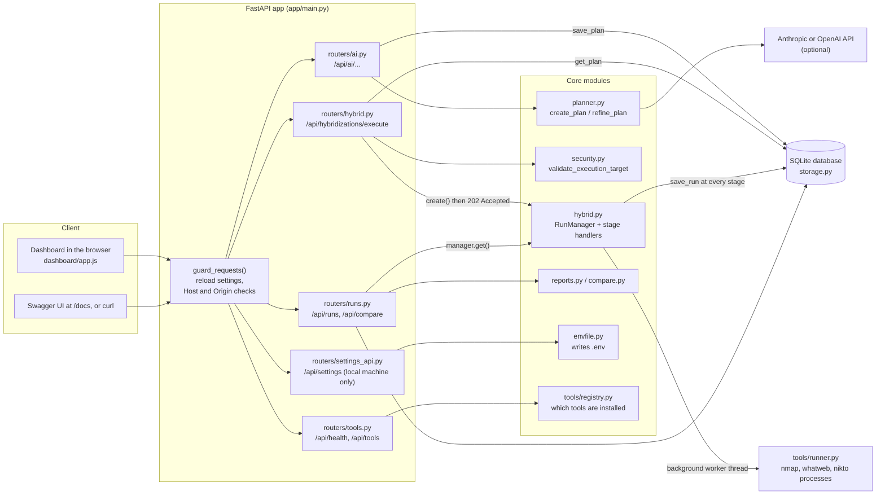
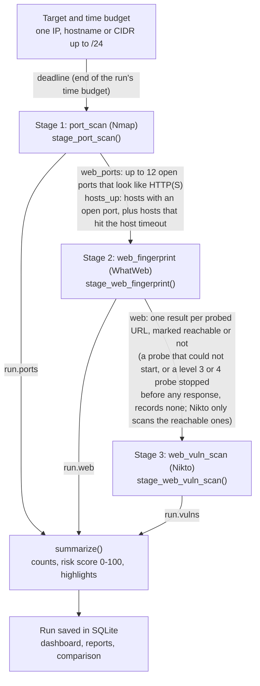

# HybridSec architecture

A guide to how the HybridSec backend is built.
Terms in *italics* on first use are explained in the [Glossary](#8-glossary) at the end.

---

## 1. Purpose

HybridSec turns three established, open-source security scanners into one *hybrid tool*. Nmap finds the
open *ports* on a target and the services behind them, WhatWeb identifies the software behind every web
service it found (*fingerprinting*), and Nikto checks those web services for known problems. Instead of
running three programs by hand and comparing three outputs, the operator types one target, confirms they
are authorized to test it, and receives one correlated result: open ports, technologies, findings, a risk
score, downloadable reports and a history that can be compared over time. An AI planner (optional) designs
the workflow from a plain-language objective, and a built-in *rules planner* does the same without any API
key. Everything runs locally behind a small web dashboard, and every step is designed for **authorized
testing only**.

---

## 2. Big picture

### 2.1 How a request travels through the system

The browser only ever talks to the FastAPI application. Every request first passes the request guard in
`main.py`, then reaches one *router* (a group of *endpoints*). Routers call the planner, the pipeline or
storage; scanners are only ever started by the pipeline.

Two things to note about this diagram:

* **A run does not block the request.** `POST /api/hybridizations/execute` answers immediately with
  *HTTP 202 Accepted* and the queued run. The scan continues on a *worker thread*, and the dashboard asks
  for progress every few moments (`GET /api/runs/{id}`).
* **The AI is only used for planning.** It never runs commands. The commands that run come from a fixed
  catalogue in code (`hybrid.py` and the profiles in the tool registry), and the AI's plan is checked and
  cleaned before it is saved.

### 2.2 The pipeline stages and what each one hands to the next

Each tool owns one *stage*. A stage reads what earlier stages produced from a shared dictionary (the
`StageContext` in `hybrid.py`) and adds its own results to the run.

If a workflow has no Nmap stage, the web stages assume the standard web ports 80 and 443 on the target
(`_web_targets()` in `hybrid.py`). Only the first stage is essential: if it fails, the run fails; if a
later stage fails, the run still completes with the earlier results (see [section 4](#4-key-design-decisions)).

Custom tools registered on the dashboard's Custom tools page add one `custom_tool` stage each after these
three (`stage_custom_tool()`). A tool that runs once per web URL probes the same URLs as Nikto
(`_web_targets_that_answered()`); one that runs once on the target gets the validated target. Their output
goes to `run.custom_outputs` as text and never reaches `summarize()`, so it changes no count and no score
(see [section 6](#6-how-to-extend-with-a-new-tool)).

---

## 3. Module-by-module guide

All backend code lives in `app/`. The three `__init__.py` files (`app/`, `app/routers/`, `app/tools/`)
only mark folders as Python packages and contain a one-line description.

### `app/main.py` - the front door

* **Responsibility:** creates the FastAPI application, runs startup and shutdown tasks, checks every
  request, connects the routers, keeps two legacy URLs from the original project, and serves the dashboard.
* **Key functions:**
  * `lifespan()` - at startup creates the database tables and marks runs interrupted by a crash as
    failed; at shutdown kills scanner processes that are still running.
  * `guard_requests()` - runs before every request: reloads settings, then calls
    `_reject_unknown_host()` (DNS-rebinding defence) and `_reject_cross_site()` (cross-site defence).
  * `legacy_plan()` / `legacy_execute()` - the original `/ai/plan` and `/hybridizations/execute` paths.
* **In one sentence:** every request passes the guards in `main.py` before any router sees it.

### `app/config.py` - settings

* **Responsibility:** reads configuration from the process environment and the `.env` file into one shared
  `settings` object.
* **Key functions:** `Settings.reload()` (re-reads everything), `Settings.resolved_ai_provider()` (chooses
  Anthropic, OpenAI or the rules planner), `_resolve_env_file()` (decides which `.env` file is used;
  tests point it at a temporary file).
* **In one sentence:** `config.py` turns `.env` into one settings object that every module shares and that
  is refreshed on every request.

### `app/envfile.py` - safe `.env` editing

* **Responsibility:** lets the Settings page change individual keys in `.env` without disturbing comments
  or other keys.
* **Key functions:** `update_env_file()` (change keys, remove duplicates, append new keys; the file is split
  with python-dotenv's own parser, so a line inside a quoted value, or one python-dotenv cannot read, is never
  taken for a setting; a rewritten line keeps its `export` prefix and end-of-line comment; the extra lines of
  a rewritten key's old multi-line value stay as comments; and a save that would change any other setting is
  refused before anything is written),
  `validate_value()` (refuses line breaks, control characters, single quotes, `${` and a trailing or doubled backslash), `_write_atomically()` (temporary file, then
  rename, so a crash never leaves a half-written file).
* **In one sentence:** `envfile.py` edits `.env` safely: only the changed keys, never a half-written file,
  and no value that could smuggle in another setting.

### `app/schemas.py` - the data dictionary

* **Responsibility:** defines every request body, response body and stored document as a *Pydantic*
  model. FastAPI validates incoming JSON against them and shows their descriptions in Swagger.
* **Key models:** `ExecuteRequest` (what to scan, and which profile each tool uses), `Run` with `StageResult`,
  `PortFinding`, `WebFinding`, `VulnFinding` and `RunSummary` (what a scan produced), `PlanRequest` / `Plan` /
  `PlanResponse` (planning), `ToolInfo` with `ToolProfileInfo` (the tool catalogue the dashboard draws).
* **In one sentence:** if you want to know what a JSON field means, `schemas.py` is the place to look.

### `app/security.py` - target validation and scope

* **Responsibility:** guarantees that only one explicitly authorized, in-scope target can reach a scanner.
* **Key functions:** `normalize_target()` (accepts one IP, hostname or CIDR up to /24 and rejects shell
  characters, URLs, options and nmap range syntax), `check_scope()` and `matches_allowlist_entry()`
  (optional allow-list), `validate_execution_target()` (authorization flag, then syntax, then scope).
* **In one sentence:** `security.py` is the gate between user input and the scanners.

### `app/planner.py` - the AI planner

* **Responsibility:** turns an objective and a tool list into a structured plan, and refines a plan from
  operator feedback.
* **Key functions:** `create_plan()` (ask the configured provider, fall back to the rules planner on any
  error; when the model added a tool that was not selected, which normalising removes, the plan's note names
  it), `refine_plan()` (create the next revision from feedback; feedback may change the tool set, so only a
  tool that is not one of the three built-in tools is removed from the model's revision, together with the
  outputs and rate limits that describe only it, and a limitation line names it, because a revision's note
  means that the feedback was not applied), `rules_plan()` (deterministic plan without an API key),
  `_normalize_plan()` (keeps only allowed tools, one step each, sets every command template to the command the
  pipeline runs, and always requires authorization), `describe_error()` (one readable note with a hint; the
  exception's class decides before its text, which may quote the model's answer).
* **In one sentence:** `planner.py` asks an AI model for a structured plan, checks and cleans the answer,
  and falls back to a built-in planner so planning always works.

### `app/hybrid.py` - the pipeline engine

* **Responsibility:** executes runs: one stage per tool, in order, each feeding the next; tracks running
  runs; computes the summary and risk score; produces simulated data.
* **Key functions:**
  * `RunManager.create()` - registers a run, enforces the concurrent-run cap, starts the worker thread.
  * `RunManager._execute()` with `_run_stage()` and `_finish()` - the run lifecycle on the worker thread.
  * `stage_port_scan()`, `stage_web_fingerprint()`, `stage_web_vuln_scan()` - the three stage handlers,
    each with a simulated branch and a live branch (`_run_nmap()`, `_run_whatweb()`, `_run_nikto()`).
    Each handler looks up the tool's profile for the run with `profile_for_run()` (the preset option set
    the operator chose, see the registry) and puts its arguments into the command line; the simulated
    branch shapes its sample data by the same profile (a quick Nmap scan has no versions, a Nikto
    `-Tuning` profile keeps only the findings in its categories).
    `_run_nmap()` adds `-6` for IPv6 addresses and blocks and for host names that resolve only to IPv6
    (`_scan_over_ipv6()` asks the system resolver), and marks the stage `partial` when Nmap was stopped
    at the time limit, its output was cut off or a host hit the host timeout (`_nmap_caveats()` says which).
    When a host hit the host timeout, no open port was found at all and the profile does version detection,
    `_rescan_without_versions()` scans the ports once more without `-sV` and `-sC` (the other options kept)
    if at least 5 s of the stage's share and of the run are left. Ports it finds complete the stage as
    partial, without products or versions; otherwise the failure note says what the second scan gave.
  * `stage_custom_tool()` with `_run_custom()` and `_keep_output()` - runs one registered custom tool after
    the built-in stages: once on the target or once per URL that answered, each call limited by the tool's own
    time limit, its share of the stage and the run deadline, and read with a hard output limit on each of
    stdout and stderr. All the custom tools of a run share one time weight (`CUSTOM_TOOLS_WEIGHT`, 0.2: a
    sixth of the budget when all three built-in tools run), which `_stage_budgets()` takes from the built-in
    stages' shares but never from the minimum times those stages need. When the budget left after those
    minimums cannot give a custom call its `MIN_CUSTOM_SECONDS` (10 s), the custom stages get no share and
    the built-in stages exactly the shares they would have without custom tools; a custom call then runs only
    on time the built-in stages left over before the run deadline, and when none is left the stage fails with a
    message that names the budget that would be enough (`_custom_budget_needed()`). Each output
    records how the call `ended` (it exited, was stopped at its time limit, for printing too much or by the
    shutdown, was not started, or was simulated; only a call that exited has an exit code) and whether the
    run's limit on custom-tool output cut it (`run_limit`). The output is kept, never scored, and a custom
    stage never makes the run `partial` (`_has_gaps()`).
  * `summarize()` - counts, the 0-100 risk score and the highlights.
* **In one sentence:** `hybrid.py` is what makes the three scanners one hybrid tool, by feeding each
  stage's output into the next.

### `app/storage.py` - persistence

* **Responsibility:** keeps plans, runs and custom tools in a local *SQLite* database, in the tables
  `plans`, `runs` and `custom_tools`. Each plan, run or custom tool is stored as one JSON document, with a few
  columns copied out for sorting (a custom tool's row is keyed by its name).
* **Key functions:** `save_run()` / `get_run()`, `save_plan()` / `get_plan()`, `list_runs()` (fast history
  list), `count_runs()` (totals for the Overview), `fail_stale_runs()` (marks runs left "running" by a crash
  as failed; a document it cannot read only has its status changed, so one damaged document never stops
  the server from starting). A plan that cannot be read is left out of the plan list; a run whose document
  cannot be read stays in the history with the status `unreadable` (built from its own row), so it is counted
  and can be deleted; a row whose id the API cannot address is left out of both. Opening either raises
  `DocumentUnreadable`, which the API answers with a 422 that says so. Text that is not UTF-8 is read with
  replacement characters, so it never stops startup or a list. For custom tools: `add_custom_tool()` counts
  the rows and inserts in one locked step (added, full at ten tools, or exists when the name is taken);
  `custom_tool_rows()` reads the table once and returns the readable tools and the row names of the others (a
  document that cannot be read, or that holds a tool with another name), which `list_custom_tools()` and
  `unreadable_custom_tools()` return separately; and `delete_custom_tool()` removes a row by its row name, so
  an unreadable row, which still counts towards the ten, can be deleted too. A row whose name no request can
  carry (no name, a binary one, `.` or `..`, which only a hand edit can store) is logged and neither listed
  nor counted.
* **In one sentence:** `storage.py` saves everything locally, and the run is saved at every stage
  transition so completed work survives a restart.

### `app/reports.py` - reports

* **Responsibility:** renders a run as JSON, CSV, Markdown or a self-contained HTML page. Each custom-tool
  call is listed with how it ended (an exit code only when the program exited by itself; otherwise stopped at
  the time limit, for printing too much or by the server shutdown, not started, or simulated) and, when the
  run's limit on custom-tool output cut it, a note saying so; a call that kept no output says why.
* **Key functions:** `render()` (choose the format), `render_csv()` (with protection against spreadsheet
  *formula injection*), `render_markdown()` and `render_html()` (every value from a tool is *escaped*).
* **In one sentence:** `reports.py` turns a run into a document you can hand in, and makes sure hostile
  tool output cannot break or attack that document.

### `app/compare.py` - run comparison

* **Responsibility:** shows what changed between two runs: ports, technologies and findings added or
  removed, changed service versions, and the change in risk score (`risk_delta`, null unless both runs
  completed, because only a completed run is scored).
* **Key functions:** `compare_runs()`, `_diff_ports()`, `_vuln_key()` (matches findings while ignoring
  the ETag inode, size and mtime values Nikto copies into its messages, which change with the file, and the
  per-request values of an uncommon header such as `x-runtime`; advisory ids such as CVE numbers and
  versions stay in the key, and two findings with the same key are counted, not merged, so a second
  advisory on the same URL is never hidden).
* **In one sentence:** `compare.py` answers "what changed since last time?" without reporting noise.

### `app/routers/ai.py` - planner endpoints

* **Responsibility:** `POST /api/ai/plan`, `GET /api/ai/plans`, `GET /api/ai/plans/{id}`,
  `POST /api/ai/plans/{id}/refine`.
* **Key functions:** `plan()` (rejects unknown tools, plans, saves), `refine()` (saves a new revision).
* **In one sentence:** the planner endpoints validate input, call `planner.py` and save every revision.

### `app/routers/hybrid.py` - starting a run

* **Responsibility:** `POST /api/hybridizations/execute`, the only way to start a scan.
* **Key functions:** `execute()` (the checklist), `_select_tools()` (plan or tool list, never adding tools to
  an approved plan; an unknown name is answered with the supported tools, which name only the custom tools a
  run can use, and those only to the machine running HybridSec), `_check_custom_tools()` (a run with custom
  tools needs at least one built-in tool, a request from the machine running HybridSec (403 otherwise) and
  definitions that still pass the rules; a stored tool named like a built-in tool, which only a hand edit can
  store, must be deleted first), `_select_profiles()` (every profile must name a tool of the run and a profile
  the tool offers; tools not named get their default), `_require_first_tool_installed()` (refuses a live run
  whose first tool is missing).
* **In one sentence:** every run must pass this checklist, in a fixed order, before anything is started.

### `app/routers/runs.py` - history, reports and comparison

* **Responsibility:** list, fetch and delete runs, download reports, compare two runs.
* **Key functions:** `get_run()` (live progress while running), `report()`, `compare()`, `delete_run()`
  (refuses runs that are still executing).
* **In one sentence:** everything the dashboard does with finished runs goes through this router.

### `app/routers/tools.py` - system information and custom tools

* **Responsibility:** `GET /api/health` (configuration summary for the Overview page), `GET /api/tools`, and
  the custom-tool endpoints `GET` / `POST /api/tools/custom` and `DELETE /api/tools/custom/{name}`, which
  answer only to the machine running HybridSec (`require_local`). The listing gives the allowed programs as
  written in `.env` (without those that are always refused), each tool with its install status (`blocked`
  when its program is found but the file it resolves to is refused) and the names of stored tools whose
  definition can no longer be read (`unreadable`), which DELETE removes by that name. The route is
  `{name:anytext}` (Starlette's `path` convertor with line breaks too) and reads the name once from the raw
  path, so a percent-encoded name with `/`, `?`, `#`, `%` or a line break reaches the row it names.
* **Key functions:** `health()`, `tools()`, `custom_tools()`, `add_custom_tool()`, `delete_custom_tool()`.
* **In one sentence:** tells the dashboard which planner and tools are available and which limits apply, and
  lets the local operator register extra tools.

### `app/routers/settings_api.py` - the Settings page

* **Responsibility:** read and change configuration from the dashboard, and test the planner.
* **Key functions:** `require_local()` (only the local machine may use these endpoints; it builds on
  `peer_is_local()`, which the execute endpoint also asks before it runs a custom tool), `put_settings()`
  with `_env_changes()` (validate, then write `.env`), `test_planner()`.
* **In one sentence:** lets the operator paste an API key or change limits without editing files, while
  never revealing a secret and never accepting a request from another computer.

### `app/tools/registry.py` - the tool catalogue

* **Responsibility:** describes each supported tool (`ToolSpec` entries in `TOOLS`) and detects which ones
  are installed. Each spec carries the tool's `profiles`: `ToolProfile` entries (key, label, description
  and the arguments they add) that the operator picks from a drop-down on the New Run form. The first
  profile is the default and is the tool's plain, non-exploitative invocation; the others are variants with
  the same discipline (Nmap's default scripts or polite timing, WhatWeb's aggression levels, subsets of
  Nikto's tests). Only the key travels in a request, so a client can never add a flag of its own.
* **Key functions:** `resolve_binary()` (finds the executable on the *PATH*), `availability()`,
  `order_tools()` (puts tools in pipeline order), `unknown_tools()`, `find_profile()` / `default_profile()`
  / `profile_for_run()` (resolve a profile key, falling back to the default) and `profile_label()` (its
  name for reports).
* **In one sentence:** the single list of tools, and of the ways each may be used, that the rest of the
  code relies on; adding a tool or a profile starts here. (`order_tools()` and `unknown_tools()` also accept
  the names of registered custom tools, which always sort after the built-in tools.)

### `app/tools/custom.py` - custom tools

* **Responsibility:** the rules for tools the operator registers on the Custom tools page, and the helpers that
  run them. A definition is a name, a program, an argument list in which only `{target}` and `{url}` are filled
  in, a scope (once on the target or once per web URL) and a time limit per call.
* **Key functions:** `validate_definition()` (every rule, with a message that says which one failed;
  `_check_host()` refuses arguments that name another host or send the traffic elsewhere),
  `allowed_programs()` (`HYBRIDSEC_CUSTOM_PROGRAMS`, or a default list of information-gathering programs; an
  entry written as a path allows only that file, a relative one read from the folder HybridSec was started
  from), `program_problem()` and `find_program()` (known shells, interpreters, launchers and database or code
  consoles, script files, attack tools and the built-in scanners are refused by name, as typed and as the
  real file a symbolic link points to, and so is any file inside HybridSec's own folder), `build_command()`
  (replaces the placeholders, never `str.format`) and `clean_output()`.
* **In one sentence:** lets the operator add a tool without code while keeping the safety story true: no shell,
  no fixed address, URL or dotted host name in the arguments (only `{target}` and `{url}` point the tool at a
  host; short IPv4 forms and single-word names are trusted), no exploitation, no secrets, and output that is
  kept but never scored.

### `app/tools/runner.py` - running scanners safely

* **Responsibility:** starts scanner processes with hard time limits and bounded output, and can kill them
  all at shutdown.
* **Key functions:** `run_command()` (argument list, never a *shell*; kills the process at the timeout but
  keeps its partial output; with `max_chars`, used for custom tools, it reads at most that many characters of
  stdout and at most that many of stderr, each stream counted on its own, and stops a process as soon as
  either passes the limit, with no exit code), `terminate_all()`.
  Each scanner starts in a process group of its own and is killed with everything it started, so a wrapper
  (`nikto.bat`, a shell script) cannot leave the real scanner running past its limit. `install_exit_cleanup()`
  (called at startup) also kills them when an exit
  skips the shutdown handler (a second Ctrl+C) or the terminal closes. On Windows the tree is found through
  the wrapper, so a wrapper that starts the scanner in the background and exits at once leaves it behind;
  there the scanners run under WSL anyway.
* **In one sentence:** the only place where HybridSec runs the scanners, and it does so without a shell so a
  target string can never become a command (the tool registry separately asks each installed binary for its
  version, also without a shell and with a 15-second limit).

### `app/tools/parsers.py` - reading scanner output

* **Responsibility:** converts raw Nmap XML, WhatWeb JSON and Nikto JSON or text into the models from
  `schemas.py`, tolerating cut-off or unexpected output.
* **Key functions:** `parse_nmap_xml_full()` (salvages complete hosts when Nmap was stopped mid-write),
  `parse_whatweb_json()`, `parse_nikto_json()` / `parse_nikto_text()`, `classify_nikto()` (keyword-based
  severity), `is_web_service()` / `url_for()` (which ports are web services and which URL to probe).
* **In one sentence:** the translators that turn three different output formats into one data model.

---

## 4. Key design decisions

| Decision | What it means | Why |
|---|---|---|
| **Hot-reloaded `.env`** | `settings.reload()` runs at the start of every request (`guard_requests()`). Non-empty values in `.env` override the process environment; a blank `KEY=` does not hide an environment value. | An operator can paste an API key or tighten the allow-list and the very next request uses it, with no restart. Reading a small file per request is cheap. Only the data directory is fixed at startup, because moving the database while running would lose the tables. |
| **Rules fallback for the AI planner** | If no provider has credentials (Anthropic: an API key, an `ANTHROPIC_AUTH_TOKEN` or an `ant auth login` profile; OpenAI: a key), or the provider fails in any way (bad credentials, no credit, network, malformed answer, a refusal), `create_plan()` uses `rules_plan()` and the response's `note` explains why. The planner makes one attempt per request (the SDK's retries are off); `HYBRIDSEC_AI_TIMEOUT` limits each connect, read and write operation of that attempt, not the whole wait. | Planning must never block a scan, and the project must be demonstrable offline. The AI's answer is also never trusted blindly: `_normalize_plan()` keeps only allowed tools and forces `authorization_required`. |
| **Simulation mode** | `simulate=true` runs the whole pipeline with synthetic results from `simulate_ports()`, `simulate_web()` and `simulate_vulns()`. Runs, stages and reports are clearly labelled "simulated". | The dashboard and pipeline can be demonstrated on any laptop without installing scanners or touching a network. Results come from a hash of the target, so the same target always gives the same data and comparisons stay meaningful. It can be switched off with `HYBRIDSEC_ALLOW_SIMULATION=false`. |
| **Loopback-only settings** | `require_local()` accepts settings requests only when the network connection comes from the *loopback* address of the same machine. API keys are never returned, only "configured: yes/no". | Settings include API keys and safety limits. Even if the server is reachable on a network, only someone sitting at that machine may change them. The check uses the connection's address, which a client cannot fake the way it can fake a header. |
| **Host and Origin guards** | `_reject_unknown_host()` refuses a *Host header* that is not one of this server's names. `_reject_cross_site()` refuses state-changing requests that a browser marks as coming from another site (*Origin* or *Sec-Fetch-Site* headers). | Defends against *DNS rebinding* and *cross-site requests*, two ways a malicious web page could make the operator's own browser drive the local API. Scripts and curl send neither browser header and keep working. |
| **Target validation and the /24 limit** | `normalize_target()` accepts exactly one IP, hostname, or *CIDR* block of at most /24 (256 addresses; /120 for IPv6). It rejects shell characters, anything starting with `-`, URLs, and Nmap range or list syntax. An optional allow-list adds a hard scope. The `authorized` flag is mandatory. | A target is passed to external programs, so it must never be interpretable as a command, an option or a list. The size limit keeps a run short and reviewable and limits the damage of a typo (10.0.0.0/8 would be 16.7 million addresses). |
| **One time budget, one slot per stage** | The operator gives one time budget. `_stage_budgets()` splits it between stages (Nmap 55 %, WhatWeb 20 %, Nikto 25 %), and the shares follow each other as slots. Before every URL, `_time_for_next_url()` checks the time left in the stage (`_stage_end()`: the end of its slot, or its whole share when an earlier stage overran) and before the run-wide deadline. URLs that no longer fit are skipped and reported, and so are web services beyond the limit of 12 per run (`MAX_WEB_TARGETS`); either makes the web stage partial. | The operator controls the total duration with a single number, and a slow host cannot make a run last for hours. A web stage may use time an earlier stage did not need, but a slow WhatWeb stage cannot use up Nikto's share. Partial results are kept and labelled instead of being thrown away. Nmap's own per-host limit is set to 80 % of its budget, so Nmap reports a slow host itself rather than being killed silently, and the rest of its share leaves room for one scan without version detection. |
| **Stage failure semantics** | Each stage ends as `completed`, `failed`, `skipped` (no input, e.g. no web services) or `simulated`. If the first stage fails, the run fails. If a later stage fails or crashes, the run still `completes` and its `error` lists the failed stages. Partial results are written as notes on a completed stage, which is also marked `partial`; `summarize()` sets the run summary's flag when the run completes with such a stage or with a failed later stage (`_has_gaps()`), so the history list, the reports (a notice, and a `coverage` column in the CSV, which says `failed` for a failed run; a CSV without any result row holds one `run` row with the run's outcome) and the comparison (a warning) show it too. "No open ports" is a valid answer when Nmap finished, not a failure; an Nmap run stopped by its time limit before it reported any host fails instead, so a timeout is never mistaken for a clean host, and a run whose port scan failed gets no clean-host highlight. A Nikto that stopped early on a URL (killed at its limit, gave up after too many errors, found no web server) never counts as a complete examination: its findings are kept and the stage is partial, and without findings the URL is a failure; one that reached its own `-maxtime` examined the URL for its whole time slice, so it is partial even without findings (Nikto 2.6.1 prints that line on its error output, so both outputs are read). A WhatWeb probe that could not start, or a level 3 or 4 probe stopped at its limit before WhatWeb logged a response, records no result for its URL, only a note: the URL is not counted as unreachable, and Nikto does not scan it. Only a completed run is scored in the dashboard and the reports. | Without the first stage there is no input for anything else, but a missing Nikto should not throw away good Nmap and WhatWeb results. Recording a crash on one stage instead of stopping the run keeps every result that was obtained, and the notes make *false negatives* visible. |
| **Linked plan revisions** | Refining a plan creates a new plan with `parent_id` and `revision + 1`; the original is never changed. A run records the `plan_id` it executed, and a run from a plan may leave planned tools out but never add one. | The project keeps a traceable history of how the design evolved, which is useful in a report. An approved plan bounds what a run is allowed to do. |

Two further design decisions:

* **Commands without a shell.** `run_command()` receives a list of arguments, so characters such as `;` or
  `$(...)` in a target are never interpreted. Together with `normalize_target()` this gives two
  independent layers of protection against command injection.
* **JSON documents in SQLite.** A run is stored as its JSON form. Adding a field to a model therefore needs
  no database migration, and the database is a single local file that is easy to inspect or delete.

---

## 5. How a run flows end to end

1. The operator fills in the New Run form in the dashboard and clicks start. The browser sends
   `POST /api/hybridizations/execute` with an `ExecuteRequest` JSON body.
2. `guard_requests()` (`main.py`) reloads the settings, checks the Host header, and checks that the request
   did not come from another site.
3. FastAPI validates the body against `ExecuteRequest` (for example `top_ports` between 1 and 65535). An
   invalid body gets *HTTP 422*.
4. `execute()` (`routers/hybrid.py`) runs its checklist, each step answering *HTTP 400* on failure (404 for an
   unknown plan, 403 for custom tools from another machine):
   1. `_validated_target()` calls `validate_execution_target()`: the `authorized` flag, then
      `normalize_target()`, then `check_scope()` against the allow-list.
   2. `_time_budget()` applies the default budget and the configured maximum.
   3. Simulation must be allowed if it was requested.
   4. `_select_tools()` rejects unknown tool names, loads the plan with `storage.get_plan()` when a
      `plan_id` is given, sorts tools into pipeline order with `order_tools()`, and defaults to Nmap + WhatWeb.
   5. `_check_custom_tools()` checks a run with custom tools: it needs at least one built-in tool, the request
      must come from the machine running HybridSec (*HTTP 403* otherwise), and every chosen definition must
      still pass the rules (the allow-list may have been shortened, or the row edited by hand).
   6. `_select_profiles()` checks that every entry of `profiles` names a tool of the run and a profile that
      tool offers, and fills in the default profile for the tools not named.
   7. A network range needs Nmap, and for a live run `_require_first_tool_installed()` checks the first tool.
5. `manager.create()` (`RunManager` in `hybrid.py`) builds a `Run` with status `queued`, the profile of every
   tool and one `StageResult` per tool, reserves a slot (answering *HTTP 429* when
   `HYBRIDSEC_MAX_CONCURRENT_RUNS` runs are already executing), saves the run with `storage.save_run()`, and
   starts a worker thread. The endpoint returns *HTTP 202* with the queued run.
6. The dashboard polls `GET /api/runs/{id}`. `get_run()` calls `manager.get()`, which returns a copy of the
   live run while it executes and the stored copy afterwards.
7. On the worker thread, `RunManager._execute()` marks the run `running`, splits the time budget with
   `_stage_budgets()`, and creates the context with the run-wide `deadline`. Before each stage it sets
   `slot_end`, the end of that stage's slot (the run's start plus the shares of this and every earlier stage).
8. For each stage, `_run_stage()` marks it `running`, saves the run, and calls the handler listed in
   `STAGE_HANDLERS`:
   1. `stage_port_scan()` runs Nmap through `_run_nmap()` and `_start_tool()`, parses the XML with
      `parse_nmap_xml_full()`, stores `run.ports`, and passes up to 12 web services on as
      `context["web_ports"]`.
   2. `stage_web_fingerprint()` builds a URL for each web service (`url_for()`), runs WhatWeb on each one
      while `_time_for_next_url()` says there is time, parses the results with `parse_whatweb_json()`, and
      stores `run.web` and `context["web"]`.
   3. `stage_web_vuln_scan()` keeps only the URLs that answered WhatWeb, runs Nikto on each one, parses
      the findings with `parse_nikto_json()` (or `parse_nikto_text()`), and stores `run.vulns`.

   A handler that raises an exception only fails its own stage; the next stage still runs.
9. `summarize()` computes the counts, the risk score and the highlights, and `_final_outcome()` decides
   whether the run `completed` or `failed`.
10. `_finish()` publishes the final status in one locked step (so a poll never sees a half-finished run),
    saves it, and frees the concurrency slot, even if saving fails.
11. The operator reads the result in the dashboard, downloads a report (`GET /api/runs/{id}/report`, which
    calls `reports.render()`), or compares it with an earlier run (`GET /api/compare`, which calls
    `compare_runs()`).
12. On a clean shutdown (Ctrl+C) `terminate_all()` kills the running scanner; `_start_tool()` reports it,
    and the run ends as failed with "The server shut down before this run finished.", its remaining
    stages skipped and its summary counting what the finished stages found. If the process died instead
    (a crash), the next startup's `lifespan()` calls `storage.fail_stale_runs()`, which marks the run
    failed with "The server restarted before this run finished." and recomputes its summary, so it never
    stays "running" forever.

---

## 6. How to extend with a new tool

The example below adds a hypothetical DNS tool; the stage name `dns_lookup` is already reserved in
`STAGE_ORDER` and in the planner's schema.

1. **Register the tool.** Add a `ToolSpec` to `TOOLS` in `app/tools/registry.py`: executable names,
   version command, install hint, its stage and at least one `ToolProfile` (the first is the default; keep
   every profile non-exploitative). Make sure the stage appears in `STAGE_ORDER` at the right position
   (stages run in that order).
2. **Parse its output.** Add a parser to `app/tools/parsers.py` that returns models from `app/schemas.py`.
   If the tool produces a new kind of result, add a model and a list field on `Run` (with a default
   value, so older stored runs still load).
3. **Write the stage handler** in `app/hybrid.py`, following the shape of `stage_web_fingerprint()`:
   read inputs from the context, provide a simulated branch, and in the live branch call
   `_require_binary()`, build an argument list, run it with `_start_tool()` (not `run_command()`
   directly: `_start_tool()` turns a process that cannot be started, or one the server's shutdown
   stopped, into a failed result, so the stage keeps what it already found and the run is recorded as
   interrupted by the shutdown), respect the time budget with `_stage_end()` and
   `_time_for_next_url()`, and end a failed or skipped stage with `_stop_stage()`. Register it in
   `STAGE_HANDLERS` and give it a share in `STAGE_TIME_WEIGHTS`.
4. **Simulation.** Add a `simulate_...()` function so the demo mode covers the new stage.
5. **Teach the planner.** Add the real command to `EXECUTOR_COMMANDS`, a template step to
   `_STEP_LIBRARY`, a one-line role to `_STEP_ROLE` (the rules plan's summary uses it; without one it only
   names the stage), the tool-to-stage mapping to `SYSTEM_PROMPT`, and the stage to the
   `PlanStep.stage` description (the `PLAN_SCHEMA` enum follows `STAGE_ORDER`).
6. **Summary and reports.** If the tool adds a new kind of result, count it in `summarize()` and show it in
   `render_csv()`, `render_markdown()` and `render_html()`.
7. **Tests.** Add a parser test and a stage-handler test that uses the `fake_scanner()` helper in
   `tests/test_api.py`, so the test-suite never starts the real tool.

The dashboard reads the tool list from `/api/tools` and draws the stage timeline from the run, so a new
tool and stage appear there automatically; only a new kind of result needs its own view in
`dashboard/app.js`.

**Registering a custom tool (no code change).** A tool whose output only needs to be kept and read can be
added on the dashboard's Custom tools page (or with `POST /api/tools/custom`), from the machine running
HybridSec only. The rules are in `app/tools/custom.py`: the program must be on `HYBRIDSEC_CUSTOM_PROGRAMS`
(edited in `.env` only; empty means curl, dig, host, nslookup, whois, sslscan, sslyze, traceroute and tracert;
an entry written as a path allows only that file, a relative one read from the folder HybridSec was started
from, and one written as a name allows that program from any folder), and known shells, interpreters and
launchers (remote shells and database, file-transfer and code consoles among them), script files, attack tools
and the built-in scanners are refused by name whatever that list says, as is any program inside HybridSec's
own folder (its `.venv` included); the allow-list decides the rest. Arguments are single tokens without
quotes; only `{target}` and `{url}` are filled in. An argument is refused when it holds a fixed address
written as four dotted numbers or in IPv6, a URL (`://`), a host name (`localhost` or a dotted name, also
followed by `?` or `#`, or after the single slash of `http:/host`; the address, URL and host-name tests decode
%-escapes first), an `@` form other than `dig @{target}`, two slashes or backslashes where a path starts (at
the start of the argument, after `=`, `,`, `:`, `@` or `<` as in curl's `-F name=<file`, or right after a
short option as in `-T//srv/share`), two backslashes anywhere or the `\??\` prefix (a network path;
`{url}/a//b` is allowed), a curl `[ ]` range, an option that routes the traffic or reads options from a file
(curl's `-K`/`--config`, `-x`/`--proxy`, `--connect-to`, `--resolve` and the like, `whois -h`), exploit
wording, or a value that looks like a password or key; curl's credential options (`-u`, `--user`, `-E`, `-b`
and the like, also inside a bundle such as `-su`) are refused too. A file name that looks like a host is
written with its folder (`./out.txt`). A secret in a header with a name of its own (`-H X-Auth:...`) cannot be
recognised, so secrets belong in the tool's own configuration, never in the arguments: a run keeps its own
copy of its custom tools (program, arguments and command lines), and runs and reports can be read from other
machines. At most ten custom tools can be registered (a stored tool whose definition can no longer be read
still counts until it is deleted); to change one, delete it and register it again (runs keep their own copy).
A run needs at least one built-in tool, cannot add a custom tool to a plan's workflow, and runs its custom
tools last; together they take one bounded share of the time budget (weight 0.2) from the built-in stages,
never their minimum times, and no share when the budget left after those minimums cannot give a call its 10 s
minimum (a call then runs only on time the built-in stages left over). Their output is shown on the run's Tool
output tab and in the reports, cleaned of control characters, capped per call at 50,000 characters on standard
output or on standard error (5,000 characters of standard error are kept) and at 200,000 per run, and never
parsed, compared or scored; each call records how it ended and whether the run's limit cut its output.
Everything else the operator types into the arguments (for example an option that follows redirects, an IPv4
address in a short or numeric form such as `127.1`, or a single-word host name) is trusted, because only the
local machine can register it; and a copied and renamed program cannot be recognised by its name, so the
allow-list is the real gate.

**Adding a profile to an existing tool** is smaller: append a `ToolProfile` to the tool's `profiles` tuple
in `app/tools/registry.py` with a key, a label, a one-sentence description and the arguments it adds (the
pipeline still appends the target, the port count, the time limits and the output format itself). The
drop-down on the New Run form, the API validation, the run page, the reports and the comparison pick it up
from the catalogue. Then add a test that captures the command line it produces (see
`tests/test_tool_profiles.py`), and, if the profile changes what the tool collects, teach the matching
`simulate_...()` function so that demonstrations show the difference too.

---

## 7. Limitations worth knowing

* **The risk score is a heuristic**, not a standard such as *CVSS*: up to 30 points for open ports, 20 for
  web services, 20 for disclosed versions and 30 for findings weighted by severity (`_risk_score()`).
* **Nikto does not grade its findings**, so severity is estimated from keywords (`classify_nikto()`); the
  simulation grades its synthetic messages the same way, so simulated and live runs agree.
* **Versions come from service banners**, which can be wrong or hidden, giving *false positives* and
  *false negatives*.
* **Time budget minimums.** Each stage has a floor: 10 seconds for Nmap and WhatWeb, 20 seconds for Nikto
  (`STAGE_MIN_SECONDS`). A stage whose proportional share (55 / 20 / 25 percent) falls below its floor is
  lifted to it, and the difference is taken from the stage with the most slack, so with all three tools any
  budget of 40 seconds or more gives every stage its minimum. Below that, the web stages skip the URLs they
  cannot finish in time and report them on the stage. Custom tools never take these minimums: their share
  (weight 0.2) only reduces the built-in shares above them, and the run deadline still caps their calls. When
  the budget left after the built-in minimums cannot give a custom call its 10 seconds, the custom stages get
  no share: they run only on time the built-in stages leave over, and when none is left they say which budget
  would be enough.
* **One target per run, by design**, and at most 12 web services are probed per run.
* **WhatWeb's heavy profile is slow.** In the live tests of 20 November 2026 one level 4 probe of a laboratory
  site needed 440 s, more than WhatWeb's share of the largest default budget in a run with all three tools.
  Such probes are stopped and reported as not probed, and Nikto then has no URL to scan.
* **One very slow service can cost the versions of a whole host.** Nmap drops all results of a host that
  reaches its host timeout. When the profile does version detection and at least 5 s are left, the ports are
  scanned a second time without it. If that scan finds open ports, they are listed without products or
  versions, and a web service on an unusual port may not be recognised as one. In every other case the port
  scan fails, as it did before.
* **Custom tools are not part of the assessment's results**: their output is kept as text, not parsed into
  findings, not compared between runs and not scored, and they cannot be part of a plan.

---

## 8. Glossary

| Term | Meaning |
|---|---|
| Hybrid tool | A tool that chains several existing tools so that each one works on the previous one's results, producing one combined result. |
| Port | A numbered door on a computer through which a network service is reached (for example 80 for web pages, 22 for SSH remote login). An *open* port has a service listening. |
| Port scan | Checking which ports on a host are open. Nmap does this in HybridSec. |
| Service banner | The text a service sends when contacted, often naming its software and version. |
| Fingerprinting | Identifying which software (web server, framework, content management system such as WordPress, JavaScript libraries) runs behind a service, from its responses. WhatWeb does this. |
| Vulnerability scanner | A tool that checks a service for known weaknesses, such as dangerous files or outdated software. Nikto is one for web servers. |
| Stage | One step of the pipeline, performed by one tool: `port_scan`, `web_fingerprint` or `web_vuln_scan`, plus one `custom_tool` stage per registered custom tool the run uses. |
| Custom tool | An extra command-line tool the operator registers on the Custom tools page. It runs after the built-in tools; its output is kept as text and never scored. |
| Simulation mode | A run that produces realistic synthetic data instead of contacting the target, for demonstrations. |
| Rules planner | HybridSec's built-in planner that produces a plan from templates, without an AI model. |
| Plan revision | One version of a plan. Refining a plan creates the next revision, linked to its parent. |
| CIDR | A compact way to write a block of IP addresses: `192.168.1.0/24` means the 256 addresses 192.168.1.0 to 192.168.1.255. A larger number after the slash means a smaller block. |
| IPv4 / IPv6 | The two versions of internet addresses (`192.168.1.5` and `2001:db8::5`). |
| Loopback | The special address a computer uses to talk to itself (`127.0.0.1`, `::1`, name `localhost`). Traffic to it never leaves the machine. |
| Allow-list / scope | An optional list of targets that may be scanned (`HYBRIDSEC_ALLOWED_TARGETS`). Anything outside it is refused. |
| DNS | The internet's phone book, which turns names such as `example.com` into IP addresses. |
| DNS rebinding | An attack in which a malicious website makes its own domain name point to `127.0.0.1`, so the victim's browser sends requests to a service on the victim's own machine. Checking the Host header defeats it. |
| Host header | The part of an HTTP request that names the server the browser thinks it is talking to. |
| Origin / Sec-Fetch-Site headers | Headers a browser adds to say which site started a request. They reveal requests started by another website. |
| Cross-site request | A request that a page on one website makes the browser send to another website, possibly without the user knowing. |
| False positive / false negative | A reported problem that is not real / a real problem that was not reported (for example because a scan ran out of time). |
| Risk score | HybridSec's 0-100 summary number. It is a heuristic, not a standard measure. |
| CVSS | The Common Vulnerability Scoring System, the industry standard for rating a single vulnerability. HybridSec does not compute it. |
| Escaping | Rewriting text so that special characters are shown literally instead of being interpreted (for example `<` becomes `&lt;` in HTML). |
| Formula injection | Text such as `=HYPERLINK(...)` in a CSV file that a spreadsheet would run as a formula. HybridSec prefixes such cells with a quote. |
| Shell / command injection | A shell is the program that interprets command lines. Command injection tricks it into running extra commands; HybridSec never uses a shell. |
| PATH | The list of folders the operating system searches for programs. A tool counts as installed when its executable is on the PATH. |
| API key | A secret string that identifies the account using an online API, such as Anthropic's or OpenAI's. |
| JSON / XML | Text formats for structured data. The API speaks JSON; Nmap reports in XML. |
| Structured output / JSON Schema | A way to make an AI model answer in an exact JSON shape described by a schema. |
| FastAPI | The Python web framework HybridSec uses for its HTTP API and the Swagger documentation at `/docs`. |
| Router / endpoint | An endpoint is one URL and method (for example `POST /api/ai/plan`); a router groups related endpoints. |
| Middleware | Code that runs before (and after) every request; here `guard_requests()`. |
| Pydantic | The library that defines and validates the data models in `schemas.py`. |
| SQLite | A database stored in a single local file, used through Python's built-in `sqlite3` module. |
| Worker thread | A separate line of execution inside the server process, used so a long scan does not block the API. |
| HTTP status codes | 201 created (custom tool registered), 202 accepted (run queued), 204 no content (deleted), 400 bad request, 403 forbidden (a local-only endpoint asked from another machine, or a cross-site request), 404 not found, 409 conflict (run still executing, or custom-tool name taken), 422 invalid body or a stored document that cannot be read, 429 too many runs at once, 500 server error. |
| `.env` file | A text file of `KEY=value` lines holding the configuration, including API keys. It is not committed to version control. |
